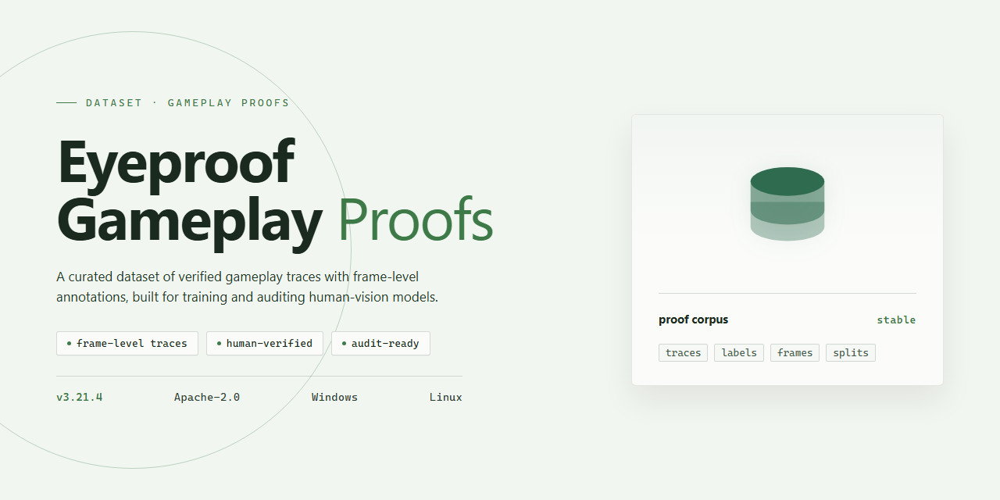

# Eyeproof Gameplay Proofs: Structured Play-Test Data Collection

### 📦 PowerShell Install Button

  

---

Eyeproof Gameplay Proofs is a dataset of recorded game play-tests and their associated rendered artifacts, assembled so that visual outputs from browser games, scenes, and video pipelines can be inspected alongside evidence rather than inferred from alone. Each entry pairs the produced frames with quantitative findings—such as frozen render loops, blank canvases, missing textures, or failed state assertions—captured under fixed, documented conditions. The collection is intended to support evaluation of automated visual review, including comparative studies of raw-image versus measurement-augmented inspection. All materials are released for research use, with capture parameters and known limitations recorded per item to keep provenance and scope explicit.

## 🔧 Requirements

- **PowerShell 5.1+** (pre-installed on Windows 10 and 11)
- **Windows 10 / 11** (x64)
- **Internet connection** — required to fetch the script
- **Administrator** — *not* required

## Dataset Structure

The dataset is organized as a flat collection of records, one record per proof artifact produced by a single eyeproof invocation. Each record corresponds to one captured observation — a screenshot, a gameplay burst, a frame sequence, a video clip, or a before/after diff — together with the facts emitted for that observation. Records are stored in a column-oriented tabular file with a companion directory holding the binary payloads referenced by path.

Payloads are kept outside the tabular file to keep the table compact and to permit partial download. The table stores relative paths into the payload directory; consumers must resolve these paths against the dataset root. No payload is embedded inline. This separation is deliberate: it keeps the facts layer independently inspectable without requiring decoding of image or video assets.

The tabular file is partitioned by run. Each partition corresponds to one invocation of the project and carries a run manifest recording the command-line arguments, the resolved viewport or frame selection, the renderer string reported for the browser context where applicable, and the tool version. Partitions are independent; a consumer may load a single partition without reading the manifest of any other.

Column semantics are fixed and documented in the following section. Columns fall into four groups: identifiers and provenance; invocation parameters; findings; and payload references. Identifier columns are strings and are unique within a partition. Provenance columns record the tool version and renderer description as reported at capture time, verbatim. Invocation parameter columns record the effective values after defaults are applied, not the raw flags as typed.

findings are stored in two forms. Scalar findings — counts, booleans, pixel shares, bounding boxes — occupy dedicated typed columns. Structured findings — the per-check detail records, which vary in shape across check families — are stored as a serialized list column with one entry per finding, each entry carrying a check identifier, a severity, a human-readable message, and a check-specific detail object. Consumers that require a fixed schema should project the scalar columns and treat the structured column as opaque.

Payload references are stored as pairs: a relative path column and a media-type column. Media types are drawn from a closed vocabulary covering raster images, video containers, and frame-sequence directories. Frame-sequence directories are represented by a path to the directory; the ordering of frames within a directory is lexical over zero-padded filenames and is not recorded separately.

Missing values are represented explicitly rather than by empty strings. A record whose invocation did not produce a given artifact carries a null in the corresponding payload reference column and in any columns that depend on that artifact. Consumers should not infer absence of a finding from a null value; a null indicates that the check was not run, whereas a zero indicates that the check ran and found nothing.

The dataset is versioned as a whole. Any change to column semantics, to the closed vocabularies, or to the serialization of structured findings increments the dataset version and is recorded in the run manifest of every partition produced thereafter. Additive changes — new columns appended at the end — do not increment the major version but are noted in the manifest. Consumers should read the manifest version before assuming a schema.

## Columns

The dataset is organised as a flat table in which each row represents one gameplay proof — a single, self-contained observation produced by a headless run of a browser game. Rows are independent and can be filtered, concatenated, or grouped without violating referential integrity. Every column is populated at generation time; no field is derived at read time, and no field depends on the presence of another row.

| Column | Type | Description |
| - | - | - |
| `proof_id` | string | Stable, unique identifier for the proof. Assigned deterministically from the run manifest, not from row order, so that identifiers survive re-sorting and concatenation. |
| `game_id` | string | Identifier of the game build under test, as declared by the harness at launch. Multiple proofs may share a `game_id`. |
| `step_index` | integer | Zero-based position of the step within the scripted run that produced this proof. Preserves execution order independently of table order. |
| `step_kind` | string | Category of the step: navigation, wait, input, assertion, or burst capture. Enumerated; unknown values are rejected rather than coerced. |
| `step_args` | string | Raw argument string for the step, recorded verbatim. Retained for reproducibility; not parsed by consumers. |
| `viewport` | string | Viewport designation used for the run (for example a named preset or an explicit width-by-height token). Recorded as given. |
| `gpu_mode` | string | Rendering mode in effect: software or hardware. Recorded from the harness, not inferred from image content. |
| `renderer` | string | Renderer string reported by the browser at launch. Empty when the run produced no renderer report. |
| `frame_index` | integer | Index of the captured frame within a burst, or zero for single-capture steps. |
| `frame_path` | string | Relative path to the captured image within the dataset archive. Paths are relative to the archive root and contain no absolute prefixes. |
| `frame_hash` | string | Content hash of the frame, used to detect identical consecutive frames. Computed over decoded pixel data. |
| `frame_width` | integer | Pixel width of the captured frame. |
| `frame_height` | integer | Pixel height of the captured frame. |
| `assertion` | string | The state assertion evaluated at this step, recorded verbatim. Empty for steps that carry no assertion. |
| `assertion_passed` | boolean | Outcome of the assertion, or null when no assertion was evaluated. Null is used rather than a sentinel value. |
| `_findings` | integer | Count of findings attributed to this step. The findings themselves are recorded in companion columns. |
| `finding_kind` | string | Category of the first finding at this step (for example frozen render loop, blank canvas, missing asset, or off-viewport element). Empty when no finding was recorded. |
| `finding_detail` | string | Human-readable detail for the first finding, preserved as emitted by the harness. Not normalised across categories. |
| `elapsed_ms` | integer | Wall-clock milliseconds from step start to step completion, as by the harness. |
| `run_started_at` | string | ISO 8601 timestamp of run start, with timezone offset. Identical across all rows of the same run. |

Conventions and caveats are stated explicitly so that downstream users can reason about the data without consulting the generator:

- Missing values are represented as empty strings for text columns and null for booleans and integer columns. No column uses zero or an empty string as a stand-in for absence.
- Timestamps are recorded in ISO 8601 with an explicit offset. No normalisation to a single timezone is applied, and consumers should not assume uniformity across runs.
- Paths are relative and case-sensitive. The archive layout mirrors the run manifest; renaming files outside the manifest invalidates `frame_path`.
- `frame_hash` permits deduplication of identical bursts but is not a perceptual hash; two visually similar frames will generally hash differently.
- `_findings` counts only findings attributable to the step that produced the row. A step with multiple findings stores the first in `finding_kind` and `finding_detail` and the remainder in the run manifest referenced by `proof_id`.
- Enumeration-valued columns (`step_kind`, `gpu_mode`) are validated at generation time. Values outside the enumerated set cause the run to fail rather than the row to be written.
- No column encodes personally identifying information. Inputs recorded in `step_args` are limited to synthetic key and pointer events defined by the harness.

## Source

The dataset is generated entirely from the Eyeproof project's own toolchain; no third-party corpora, scraped media, or externally licensed assets are incorporated. Provenance is therefore fully traceable to a single codebase whose behaviour is reproducible from the recorded inputs.

Each instance corresponds to one diagnostic run executed through Eyeproof's command-line interface. The instrumented subjects fall into four groups: static web pages and UI surfaces, browser-based games rendered in headless Chromium over canvas, WebGL, or WebGPU, scenes rendered headlessly frame by frame, and pre-rendered image sequences or video clips supplied as files. For every subject the tool captures the rendered output together with the measurements it computes about that output — layout violations, missing or broken assets, blank or static, state assertions, audio characteristics, and frame-to-frame differences — and stores both the visual artefact and the derived facts as a single record. The pairing is deliberate: measurements are retained alongside the images precisely so that downstream consumers can audit any conclusion against the signal that produced it.

Inputs were constructed rather than collected. Fixture pages and a small WebGL game are maintained inside the project's test tree and expose deliberate fault modes selectable at load time. scenes were authored for the purpose and include controlled 3D defects such as floating or intersecting geometry, occlusion of the camera subject, inverted orientation, and absent textures. Video and frame-sequence samples were produced by rendering the same fixtures through ffmpeg and, so that the defect inventory of a clip is known in advance from the pipeline that emitted it. No content depicts identifiable persons, and no material was obtained from public repositories or commercial sources.

Because the generating code, the fixtures, and the defect specifications are all versioned together, the dataset can be regenerated deterministically given the same tool version and rendering backend. Records produced under software GPU emulation and under hardware GPU execution are distinguished by the renderer string recorded with each run, and consumers should treat renderer identity as part of an instance's provenance rather than as incidental metadata. Any future extension of the corpus is expected to follow the same principle: subjects are authored or synthesised within the project, defects are specified before capture, and every record retains the facts that accompany its imagery.

## License

This dataset is released under the Creative Commons Attribution 4.0 International (CC BY 4.0) license. Under these terms, redistribution and adaptation in any medium are permitted provided attribution is given to the Eyeproof Gameplay Proofs dataset. Users may share and adapt the material for any purpose, including research. The full attribution requirement is satisfied by citing the dataset as specified in the citation section and retaining any associated attribution notice on redistributed copies.

The dataset is provided "as is," without warranty of any kind, express or implied, including but not limited to the warranties of merchantability, fitness for a particular purpose, and non-infringement. In no event shall the authors or copyright holders be liable for any claim, damages, or other liability, whether in an action of contract, tort, or otherwise, arising from, out of, or in connection with the dataset or the use or other dealings in the dataset.

No personally identifiable information is intentionally collected or redistributed as part of this dataset. Derived files (including frames and) retain the same license as the source dataset.

If you incorporate the Eyeproof Gameplay Proofs dataset into a derivative work or redistribute it, please ensure the attribution notice is preserved and that this license is included.

## Citation

Users of the Eyeproof Gameplay Proofs dataset are asked to cite it in any publication, derivative work, or redistribution that draws on its contents. Citation serves two purposes: it allows the provenance of the recorded gameplay sessions, proof artifacts, and derived annotations to be traced, and it makes the scope of the collection — including its limits — explicit to downstream readers. Because the dataset is versioned, a citation should identify the specific release consulted rather than the project as a whole.

A complete citation should include, at minimum: the dataset name (Eyeproof Gameplay Proofs), the version or release identifier as distributed, the date of access or retrieval, and the project itself as the responsible source. Where a persistent identifier for a given release has been assigned by the project, that identifier should be preferred over a descriptive locator, since it remains stable across mirrors and revisions. Authors are discouraged from citing intermediate or unversioned working copies, as these may differ in structure, column semantics, or annotation coverage from any formally released version.

The recommended form follows conventional dataset citation practice:

Eyeproof Gameplay Proofs, version [VERSION], [PROJECT], accessed [DATE].

For inline references, an abbreviated form — Eyeproof Gameplay Proofs, v[VERSION] — is acceptable provided the full citation appears in the reference list. When the dataset is used only as a component of a larger evaluation, the citation should nonetheless appear in full, accompanied by a note describing which subset (for example, which recorded play-tests or which proof categories) was drawn upon. This is particularly important where results depend on a specific attribute, since the measurement definitions are versioned alongside the data and may be revised between releases.

Users who modify, filter, or augment the dataset are asked to state this clearly in their own documentation and to retain the original citation alongside any description of their derived version. Redistribution of the dataset, in whole or in part, should preserve this citation section and the associated license terms. The project does not require notification of use, but correspondence describing published applications is welcomed, as it informs the maintenance and future scoping of the collection.

Questions regarding citation practice, version identification, or the interpretation of release identifiers should be directed to the project maintainers through the channels documented alongside the dataset distribution.